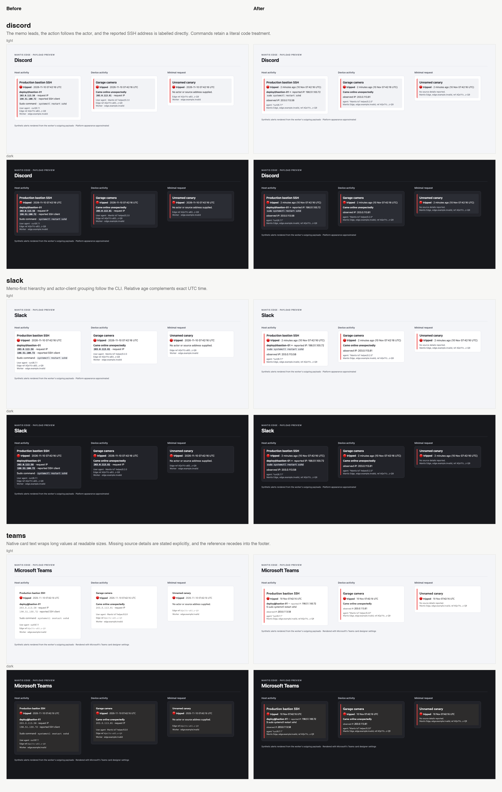

# Mantis Edge alert polish

The two-reviewer threshold remains open. Round 56 corresponds to the changes in this pull request and the after images. The threshold is at least 9 in each of eight categories from both reviewers in that round.

The alerts use the CLI's memo-first hierarchy, red tripped state and user@host actor grouping. The reported SSH client and command precede the address observed by the worker. Address-shaped values use normal body text; unexpected address input retains code formatting. Slack and Discord use code styling for commands. Teams gives commands a separate regular body-font line with a shell prompt to avoid Courier New’s weak regular strokes and dominant bold strokes, while keeping the actor prominent. Slack and Discord use client-rendered relative ages alongside exact UTC time. The reported source is marked beside the actor, while the observed address is labelled observed IP; the reported wording follows the CLI. Long memos, commands and user agents retain both ends. Long actors retain the account, identifying machine text and domain. Agents containing URLs retain their beginning to keep the product visible. Compact timestamps show day, month, time and UTC; the year remains in the raw webhook and Slack notification fallback. The minimal alert states missing source details in its secondary text. Ellipses disclose shortened values without repeating a separate notice. The agent, Mantis Edge identity, worker and a six-plus-four-character inert reference share a quiet footer. The short reference stays together when the line wraps, and long IPv6 values show their label above the complete address.

## Category scores

| Category | Opus 5.5 | Astra |
|---|---:|---:|
| Hierarchy | 8.5 | 10 |
| Typography | 8.5 | 10 |
| Spacing and layout | 8.5 | 10 |
| Colour and contrast | 8.5 | 10 |
| Iconography and controls | 8.5 | 10 |
| Consistency | 8.5 | 10 |
| Clarity | 9 | 10 |
| Character | 8 | 10 |
| **Overall** | 8.5 | 10 |
| **Categories at 9 or above** | 1/8 | 8/8 |

## Independent review history

| Round | Opus 5.5 overall | Astra overall | Opus categories at 9 | Astra categories at 9 |
|---|---:|---:|---:|---:|
| 0 | 7.5 | 8.5 | 0/8 | 2/8 |
| 1 | 7.5 | 8.5 | 0/8 | 3/8 |
| 2 | 8 | 9 | 0/8 | 6/8 |
| 3 | 7.5 | 8.5 | 0/8 | 3/8 |
| 4 | 8 | 9 | 0/8 | 5/8 |
| 5 | 8.5 | 9 | 0/8 | 7/8 |
| 6 | 8 | 9 | 0/8 | 7/8 |
| 7 | 8 | 9 | 0/8 | 7/8 |
| 8 | 8 | 9 | 1/8 | 5/8 |
| 9 | 8 | 9 | 1/8 | 7/8 |
| 10 | 8 | 9 | 0/8 | 6/8 |
| 11 | 8 | 9 | 0/8 | 6/8 |
| 12 | 8 | 9 | 0/8 | 7/8 |
| 13 | 8.5 | 9 | 2/8 | 7/8 |
| 14 | 8 | 9 | 0/8 | 6/8 |
| 15 | 8.5 | 9 | 1/8 | 5/8 |
| 16 | 8 | 9 | 0/8 | 5/8 |
| 17 | 8 | 9 | 0/8 | 6/8 |
| 18 | 8.5 | 9 | 1/8 | 7/8 |
| 19 | 8.5 | 9 | 0/8 | 8/8 |
| 20 | 8.5 | — | 0/8 | — |
| 21 | 8 | — | 0/8 | — |
| 22 | 8.5 | — | 1/8 | — |
| 23 | 7.5 | 8.5 | 0/8 | 2/8 |
| 24 | 8.5 | — | 0/8 | — |
| 25 | 8.5 | 9 | 0/8 | 7/8 |
| 26 | 8 | — | 0/8 | — |
| 27 | 8.5 | 9.5 | 1/8 | 8/8 |
| 28 | 8.5 | — | 2/8 | — |
| 29 | 8.5 | — | 3/8 | — |
| 30 | 8.5 | 9 | 1/8 | 8/8 |
| 31 | 8.5 | — | 3/8 | — |
| 32 | 8.5 | 9 | 0/8 | 7/8 |
| 33 | 8.5 | 9 | 0/8 | 7/8 |
| 34 | 8.5 | 9 | 3/8 | 6/8 |
| 35 | 9 | — | 5/8 | — |
| 36 | 8.5 | — | 2/8 | — |
| 37 | 9 | — | 5/8 | — |
| 38 | 8.5 | — | 3/8 | — |
| 39 | 8.5 | — | 2/8 | — |
| 40 | 8.5 | — | 2/8 | — |
| 41 | 8.5 | — | 1/8 | — |
| 42 | 8.5 | 9.5 | 1/8 | 8/8 |
| 43 | 8.5 | — | 4/8 | — |
| 44 | 9 | — | 5/8 | — |
| 45 | 8.5 | 9.5 | 3/8 | 8/8 |
| 46 | 8.5 | 9.5 | 3/8 | 8/8 |
| 47 | 9 | 10 | 5/8 | 8/8 |
| 48 | 8.5 | 9.5 | 3/8 | 8/8 |
| 49 | 8.5 | 9.5 | 2/8 | 8/8 |
| 50 | 8.5 | 10 | 2/8 | 8/8 |
| 51 | 8.5 | 10 | 1/8 | 8/8 |
| 52 | 9 | 10 | 5/8 | 8/8 |
| 53 | 8.5 | 9.5 | 3/8 | 8/8 |
| 54 | 8.5 | 10 | 3/8 | 8/8 |
| 55 | 8.5 | 10 | 4/8 | 8/8 |
| 56 | 8.5 | 10 | 1/8 | 8/8 |

## Complete category history

Abbreviations: H hierarchy, T typography, S spacing/layout, C colour/contrast, I iconography/controls, X consistency, L clarity, B character.

| Round | Reviewer | H | T | S | C | I | X | L | B |
|---|---|---:|---:|---:|---:|---:|---:|---:|---:|
| 0 | Opus 5.5 | 8 | 7 | 7.5 | 7.5 | 7 | 6.5 | 8 | 7 |
| 0 | Astra | 8.5 | 8 | 8 | 9 | 9 | 8.5 | 8.5 | 8 |
| 1 | Opus 5.5 | 8 | 7.5 | 7.5 | 8 | 7.5 | 7.5 | 8.5 | 7.5 |
| 1 | Astra | 8.5 | 8 | 8.5 | 9 | 9 | 8 | 9 | 8.5 |
| 2 | Opus 5.5 | 8.5 | 7.5 | 8 | 8 | 8 | 8 | 8.5 | 7.5 |
| 2 | Astra | 9 | 8.5 | 9 | 9 | 9 | 8.5 | 9 | 9 |
| 3 | Opus 5.5 | 8.5 | 7.5 | 8 | 7.5 | 7.5 | 7 | 8.5 | 7.5 |
| 3 | Astra | 9 | 8 | 8.5 | 9 | 8.5 | 8.5 | 9 | 8.5 |
| 4 | Opus 5.5 | 8.5 | 7.5 | 8 | 8 | 8 | 7.5 | 8.5 | 8 |
| 4 | Astra | 9 | 8.5 | 9 | 9 | 9 | 9 | 8.5 | 8.5 |
| 5 | Opus 5.5 | 8.5 | 8 | 8.5 | 8 | 8.5 | 8.5 | 8.5 | 8 |
| 5 | Astra | 9 | 8.5 | 9 | 9 | 9 | 9.5 | 9 | 9 |
| 6 | Opus 5.5 | 8 | 8 | 8.5 | 8.5 | 8 | 7.5 | 8.5 | 7.5 |
| 6 | Astra | 9 | 8.5 | 9 | 9 | 9 | 9 | 9 | 9 |
| 7 | Opus 5.5 | 8.5 | 8 | 8 | 8.5 | 8 | 7.5 | 8.5 | 7.5 |
| 7 | Astra | 9 | 8.5 | 9 | 9 | 9 | 9.5 | 9 | 9 |
| 8 | Opus 5.5 | 8.5 | 8 | 8.5 | 8.5 | 8 | 7.5 | 9 | 7.5 |
| 8 | Astra | 8.5 | 8.5 | 9 | 9 | 9 | 9 | 9 | 8.5 |
| 9 | Opus 5.5 | 8.5 | 7.5 | 8 | 8.5 | 8 | 8 | 9 | 7.5 |
| 9 | Astra | 9 | 8.5 | 9 | 9 | 9 | 9 | 9.5 | 9 |
| 10 | Opus 5.5 | 8 | 7.5 | 8 | 8.5 | 8 | 7.5 | 8.5 | 7.5 |
| 10 | Astra | 8.5 | 8.5 | 9 | 9 | 9 | 9 | 9.5 | 9 |
| 11 | Opus 5.5 | 8 | 7.5 | 7.5 | 8.5 | 8 | 7.5 | 8.5 | 7.5 |
| 11 | Astra | 9 | 8.5 | 9 | 9 | 9 | 9 | 9 | 8.5 |
| 12 | Opus 5.5 | 8 | 7.5 | 8.5 | 8.5 | 8 | 8 | 8.5 | 7.5 |
| 12 | Astra | 9 | 8.5 | 9 | 9 | 9 | 9 | 9.5 | 9 |
| 13 | Opus 5.5 | 8.5 | 8 | 8.5 | 9 | 8 | 8 | 9 | 7.5 |
| 13 | Astra | 9 | 8.5 | 9 | 9 | 9 | 9 | 9.5 | 9 |
| 14 | Opus 5.5 | 8 | 7.5 | 8 | 8 | 7.5 | 7.5 | 8.5 | 7.5 |
| 14 | Astra | 9 | 8.5 | 9 | 9 | 9 | 9 | 9 | 8.5 |
| 15 | Opus 5.5 | 8.5 | 8 | 8.5 | 8.5 | 8.5 | 8.5 | 9 | 7.5 |
| 15 | Astra | 8.5 | 8.5 | 9 | 9 | 9 | 8.5 | 9 | 9 |
| 16 | Opus 5.5 | 8.5 | 8 | 8 | 8.5 | 8 | 8 | 8.5 | 7.5 |
| 16 | Astra | 9 | 8.5 | 9 | 9 | 9 | 9 | 8.5 | 8.5 |
| 17 | Opus 5.5 | 8 | 8 | 8.5 | 8.5 | 8 | 8 | 8.5 | 7.5 |
| 17 | Astra | 9 | 8.5 | 9 | 9 | 9 | 9 | 8.5 | 9 |
| 18 | Opus 5.5 | 8.5 | 8 | 8 | 8.5 | 8.5 | 8.5 | 9 | 8 |
| 18 | Astra | 9 | 8.5 | 9 | 9.5 | 9.5 | 9 | 9 | 9 |
| 19 | Opus 5.5 | 8.5 | 8 | 8.5 | 8.5 | 8 | 8.5 | 8.5 | 8 |
| 19 | Astra | 9 | 9 | 9 | 9.5 | 9.5 | 9.5 | 9 | 9 |
| 20 | Opus 5.5 | 8.5 | 8 | 8.5 | 8.5 | 8.5 | 8 | 8.5 | 8 |
| 20 | Astra | — | — | — | — | — | — | — | — |
| 21 | Opus 5.5 | 8.5 | 7.5 | 8 | 8.5 | 8.5 | 8 | 8.5 | 8 |
| 21 | Astra | — | — | — | — | — | — | — | — |
| 22 | Opus 5.5 | 8.5 | 8 | 8.5 | 8.5 | 8.5 | 8 | 9 | 8 |
| 22 | Astra | — | — | — | — | — | — | — | — |
| 23 | Opus 5.5 | 8 | 7.5 | 8 | 7.5 | 7 | 7.5 | 8.5 | 7.5 |
| 23 | Astra | 8.5 | 8 | 9 | 8.5 | 8 | 8.5 | 9 | 8.5 |
| 24 | Opus 5.5 | 8.5 | 8 | 8.5 | 8.5 | 8.5 | 8 | 8.5 | 8 |
| 24 | Astra | — | — | — | — | — | — | — | — |
| 25 | Opus 5.5 | 8.5 | 8 | 8.5 | 8.5 | 8.5 | 8 | 8.5 | 8 |
| 25 | Astra | 9 | 8.5 | 9 | 9.5 | 9 | 9.5 | 9 | 9 |
| 26 | Opus 5.5 | 8.5 | 7.5 | 8.5 | 8.5 | 8 | 8.5 | 8 | 8 |
| 26 | Astra | — | — | — | — | — | — | — | — |
| 27 | Opus 5.5 | 8.5 | 8 | 8 | 8.5 | 8 | 8.5 | 9 | 8 |
| 27 | Astra | 9.5 | 9.5 | 9.5 | 10 | 10 | 10 | 9 | 9.5 |
| 28 | Opus 5.5 | 8.5 | 8 | 8.5 | 9 | 8.5 | 8.5 | 9 | 8 |
| 28 | Astra | — | — | — | — | — | — | — | — |
| 29 | Opus 5.5 | 9 | 8.5 | 9 | 9 | 8.5 | 8.5 | 8.5 | 8.5 |
| 29 | Astra | — | — | — | — | — | — | — | — |
| 30 | Opus 5.5 | 9 | 8.5 | 8.5 | 8.5 | 8.5 | 8 | 8.5 | 8 |
| 30 | Astra | 9 | 9 | 9 | 9.5 | 9.5 | 9 | 9 | 9 |
| 31 | Opus 5.5 | 9 | 8.5 | 8.5 | 9 | 8.5 | 8.5 | 9 | 8 |
| 31 | Astra | — | — | — | — | — | — | — | — |
| 32 | Opus 5.5 | 8.5 | 8 | 8.5 | 8.5 | 8 | 8 | 8.5 | 8 |
| 32 | Astra | 9 | 8.5 | 9 | 9.5 | 9.5 | 9.5 | 9 | 9 |
| 33 | Opus 5.5 | 8.5 | 8 | 8 | 8.5 | 8.5 | 8.5 | 8.5 | 8 |
| 33 | Astra | 9 | 8.5 | 9 | 9.5 | 9.5 | 9.5 | 9 | 9 |
| 34 | Opus 5.5 | 9 | 8.5 | 9 | 9 | 8.5 | 8.5 | 8.5 | 8 |
| 34 | Astra | 9 | 8.5 | 9 | 9 | 9 | 9 | 8.5 | 9 |
| 35 | Opus 5.5 | 9 | 8.5 | 9 | 9 | 8.5 | 9 | 9 | 8.5 |
| 35 | Astra | — | — | — | — | — | — | — | — |
| 36 | Opus 5.5 | 9 | 8.5 | 8.5 | 8.5 | 8.5 | 9 | 8.5 | 8.5 |
| 36 | Astra | — | — | — | — | — | — | — | — |
| 37 | Opus 5.5 | 9 | 8.5 | 8.5 | 9 | 9 | 9 | 9 | 8.5 |
| 37 | Astra | — | — | — | — | — | — | — | — |
| 38 | Opus 5.5 | 9 | 8.5 | 8.5 | 9 | 8.5 | 8.5 | 9 | 8.5 |
| 38 | Astra | — | — | — | — | — | — | — | — |
| 39 | Opus 5.5 | 9 | 8.5 | 8.5 | 8.5 | 8.5 | 8.5 | 9 | 8 |
| 39 | Astra | — | — | — | — | — | — | — | — |
| 40 | Opus 5.5 | 8.5 | 8 | 8 | 9 | 8.5 | 8.5 | 9 | 8 |
| 40 | Astra | — | — | — | — | — | — | — | — |
| 41 | Opus 5.5 | 8.5 | 8 | 8.5 | 8.5 | 8.5 | 8.5 | 9 | 8 |
| 41 | Astra | — | — | — | — | — | — | — | — |
| 42 | Opus 5.5 | 8.5 | 8.5 | 8.5 | 8.5 | 8.5 | 8.5 | 9 | 8 |
| 42 | Astra | 9.5 | 9 | 9 | 9.5 | 10 | 9.5 | 9.5 | 9.5 |
| 43 | Opus 5.5 | 9 | 8.5 | 9 | 9 | 8.5 | 8.5 | 9 | 8.5 |
| 43 | Astra | — | — | — | — | — | — | — | — |
| 44 | Opus 5.5 | 9 | 8.5 | 9 | 9 | 8.5 | 9 | 9 | 8 |
| 44 | Astra | — | — | — | — | — | — | — | — |
| 45 | Opus 5.5 | 9 | 8.5 | 8.5 | 9 | 8.5 | 8.5 | 9 | 8 |
| 45 | Astra | 9.5 | 9.5 | 9.5 | 10 | 10 | 10 | 9.5 | 9.5 |
| 46 | Opus 5.5 | 9 | 8.5 | 8.5 | 9 | 8.5 | 8 | 9 | 8 |
| 46 | Astra | 9.5 | 9.5 | 9.5 | 10 | 10 | 9.5 | 9.5 | 9.5 |
| 47 | Opus 5.5 | 9 | 8.5 | 9 | 9 | 9 | 8.5 | 9 | 8.5 |
| 47 | Astra | 10 | 10 | 10 | 10 | 10 | 10 | 10 | 10 |
| 48 | Opus 5.5 | 9 | 8.5 | 8.5 | 8.5 | 8.5 | 9 | 9 | 8.5 |
| 48 | Astra | 10 | 9.5 | 9.5 | 10 | 10 | 10 | 10 | 10 |
| 49 | Opus 5.5 | 8.5 | 8 | 8.5 | 9 | 8.5 | 8.5 | 9 | 8.5 |
| 49 | Astra | 9.5 | 9 | 9.5 | 10 | 10 | 9.5 | 9.5 | 9.5 |
| 50 | Opus 5.5 | 9 | 8.5 | 8.5 | 8.5 | 8.5 | 8.5 | 9 | 8.5 |
| 50 | Astra | 10 | 10 | 10 | 10 | 10 | 10 | 10 | 10 |
| 51 | Opus 5.5 | 8.5 | 8 | 8.5 | 8.5 | 8.5 | 8.5 | 9 | 8 |
| 51 | Astra | 10 | 10 | 10 | 10 | 10 | 10 | 10 | 10 |
| 52 | Opus 5.5 | 9 | 8.5 | 9 | 9 | 8.5 | 9 | 9 | 8.5 |
| 52 | Astra | 10 | 10 | 10 | 10 | 10 | 10 | 10 | 10 |
| 53 | Opus 5.5 | 9 | 8.5 | 8.5 | 9 | 8.5 | 8.5 | 9 | 8.5 |
| 53 | Astra | 9.5 | 9.5 | 9.5 | 10 | 10 | 9 | 9 | 9.5 |
| 54 | Opus 5.5 | 9 | 8.5 | 9 | 8.5 | 8.5 | 8.5 | 9 | 8 |
| 54 | Astra | 10 | 10 | 10 | 10 | 10 | 10 | 10 | 10 |
| 55 | Opus 5.5 | 9 | 8.5 | 9 | 9 | 8.5 | 8.5 | 9 | 8 |
| 55 | Astra | 10 | 10 | 10 | 10 | 10 | 10 | 10 | 10 |
| 56 | Opus 5.5 | 8.5 | 8.5 | 8.5 | 8.5 | 8.5 | 8.5 | 9 | 8 |
| 56 | Astra | 10 | 10 | 10 | 10 | 10 | 10 | 10 | 10 |

Round 0 used the preceding pass's exact final screenshots with a fresh review from both models. The six standard screenshots cover Slack, Discord and Teams in light and dark themes, with synthetic host activity, a device event and a minimal request. Teams moved to Microsoft's renderer in round 3, the surrounding designer frame was excluded from round 7, and the Segoe-compatible Selawik font was used from round 11. From round 12 the reviews also received a product reference generated by the current CLI formatters and a 320-pixel Teams stress example. From round 18 the narrow Teams examples are refreshed for each candidate in both themes. From round 23 the reviewers receive the previous round’s screenshots to assess regressions; earlier rounds in this continuation used independent current-only reviews. A separate unscored Opus design consultation preceded round 23; its proposal was implemented and assessed in fresh scoring sessions, and was not counted toward the threshold. From round 26 the brief also specifies native text, footer, time and colour capabilities; the rubric, peers and target remain unchanged. From round 32, every platform has narrow captures in both themes, and the Teams preview falls back to a system font for the ellipsis glyph because Selawik rendered it as a single dot in this browser. The production font remains host-owned. From round 37, the capability brief also explicitly states that payloads cannot branch on viewing width and emoji presentation follows the client platform. From round 39 an additional six-panel montage covers 512-pixel payload widths, alongside the unchanged medium and narrow captures. From round 47 the same montage also includes Teams details at 2× device pixel density, with a 368-pixel CSS payload area and unchanged host settings and text sizes. The original 1× views remain in the review. This supplements the preview evidence and is not a live Teams-client check. The current Microsoft designer bundle was rechecked and still specifies Courier New for monospace text. The comparison re-renders the original Teams payload using the same settings as the after image. [Microsoft Teams theme settings](https://github.com/microsoft/AdaptiveCards/tree/main/samples/HostConfig) · [Selawik](https://github.com/microsoft/Selawik)

## Reviewer findings

### Opus 5.5

- **Slack and Discord, host and device cards, light and dark, 368 px, 320 px and 512 px.** The italic labels 'reported IP:' and 'observed IP:' match their values in size and colour, so they recede less than the small muted Teams labels and the IP values do not stand out as the machine-readable data.
- **All platforms, status row on all three cards, light and dark.** The memo, 'tripped' and the actor or device event form three consecutive bold-led lines, so only the title's size separates the first three reading stops.
- **Teams host activity, light and dark, 368 px, 320 px and 512 px.** The command is set in the proportional body face, so only the '$' prefix marks it as a literal, while Slack and Discord show it in code.
- **All platforms, minimal request card, light and dark, 368 px and 320 px.** 'No source details reported.' is the card's only incident finding, yet it sits in the footer tier directly above the product and reference line, so it reads as metadata.

### Astra

No remaining findings were returned in round 56.

## Verification

TypeScript checks and 134 Edge tests passed for round 56. A subsequent CI finding prompted equivalent single-pass Teams escaping and a backslash regression test; TypeScript and all 135 Edge tests passed afterward. The final standard fixture payloads for all three platforms remain byte-for-byte identical to round 56. Display budgets are 60 characters for the memo, 36 for the actor, 52 for the command and 38 for the agent; the raw webhook retains full values. Microsoft's card renderer showed no overflow or links in the 320-pixel light and dark checks, including long values, IPv6 and URL-shaped input. The status marker and timestamp remained visible. Chat alert payloads contain a shortened inert reference. The raw webhook tests still verify delivery of the full trigger URL as machine data.

Slack and Discord are previews generated from outgoing payloads. Teams uses Microsoft's card renderer and published theme settings. Real delivery and final client rendering require dedicated test destinations. Live-client verification was unavailable. Payloads were checked locally; no live alerts were sent. Slack and Discord use supported rich text and embed formatting. [Slack relative dates](https://docs.slack.dev/reference/block-kit/block-elements/date-element/) · [Discord timestamp syntax](https://github.com/discord/discord-api-docs/blob/main/developers/reference.mdx)

## Remaining review boundary

The requested threshold has not been achieved. Round 56 gives Astra 10 in every category; Opus gives clarity 9, character 8, and the other six categories 8.5. Prior overall scores of 9 do not satisfy the per-category requirement. Every score above is recorded as returned by its reviewer.

Further validation needs the actual chat clients. Comparable reviews have requested opposing treatments for Teams command weight and font, the empty-source message tier, and label punctuation. The current candidate retains the CLI's bold tripped status and actor grouping, makes reported versus observed addresses explicit, and uses a readable Teams command with a shell prompt. The review record preserves the alternatives and unresolved findings.

This report records the final review checkpoint. Live-client delivery remains unverified, and the changes have not been deployed.

[Before/after comparison](before-after.png)

